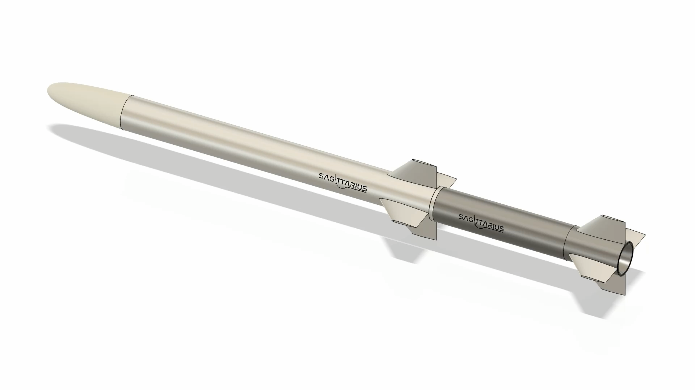
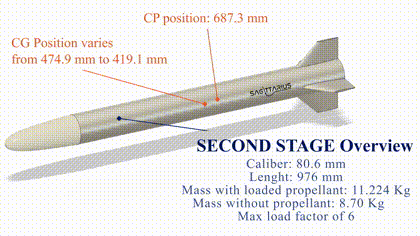
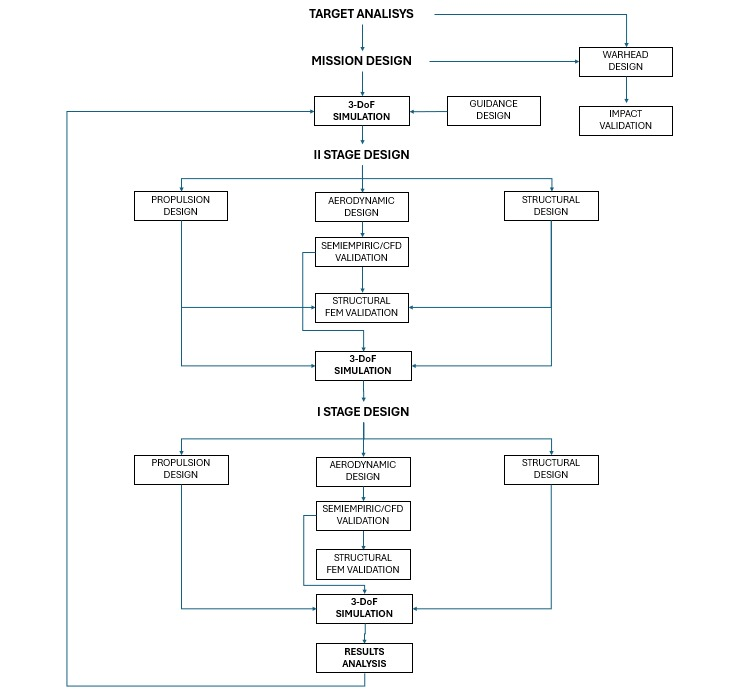
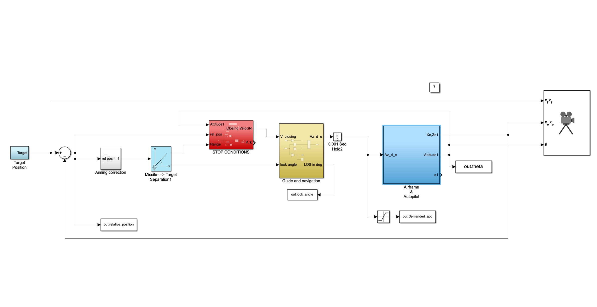
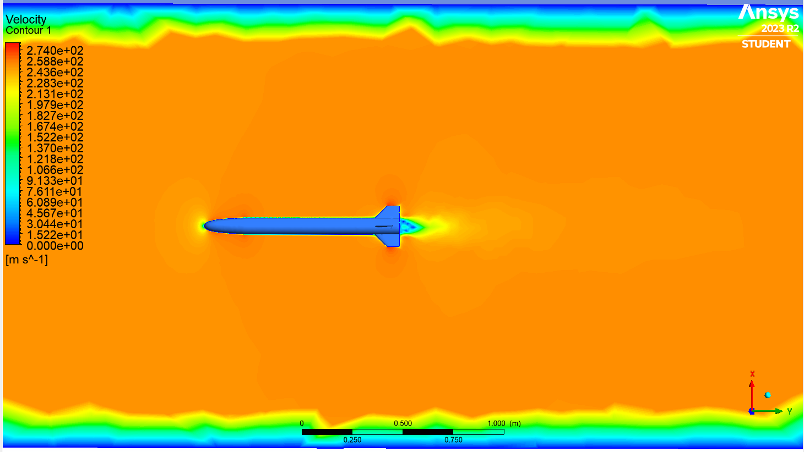
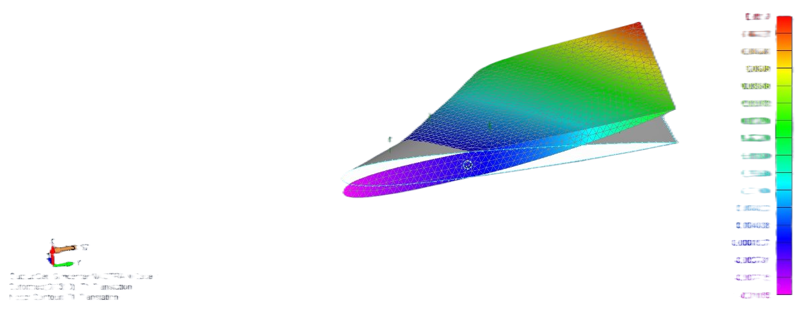
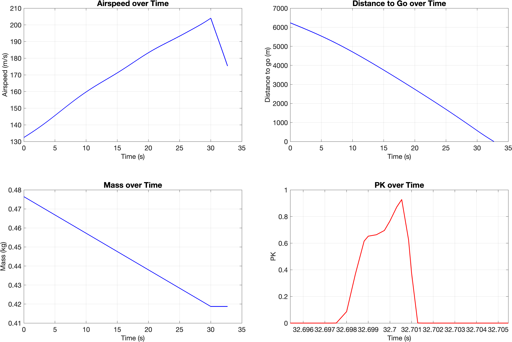

# SAGITTARIUS

### A multidisciplinary aerospace design project — from mission definition to system-level assessment

**Systems Engineering · Concurrent Engineering · MATLAB/Simulink · Aerodynamics · Propulsion · Structures · CAD**

SAGITTARIUS is an **academic preliminary-design study of a two-stage Counter-UAV interceptor**, developed by a team of seven Aerospace Engineering students at the **University of Naples Federico II** in collaboration with **MBDA Italy** (Aerospace Design Project, 2023/2024).

The project brought together mission analysis, flight simulation, guidance and control, propulsion, aerodynamics, structural analysis and mechanical design. Rather than developing each discipline independently, we organized the work around a common system-level model, using its results to inform design decisions and revisit subsystem assumptions.

**The most important outcome is the engineering approach:** how a multidisciplinary team turned a complex problem into a coherent preliminary design through iteration, shared interfaces and simulation-driven decisions.

**[Published conference paper](https://doi.org/10.21741/9781644904251-90)** · **[Paper PDF](documents/SAGITTARIUS_paper_AIDAA.pdf)** · **[Full technical report](documents/SAGITTARIUS_REPORT_FINAL.pdf)** · **[Project presentation](presentation/Sagittarius_presentation.pdf)**

<p align="center">
  
</p>
<p align="center"><em>Preliminary SAGITTARIUS configuration — a shared reference for multidisciplinary integration.</em></p>

## The project

The design task was to investigate a **compact, two-stage surface-to-air concept** for a representative Counter-UAV mission. It required the team to consider not just flight behavior, but the relationships between mission objectives, mass properties, propulsion, aerodynamic characteristics, structural constraints and mechanical integration.

The work resulted in:

- A **preliminary system architecture and CAD configuration**, developed through coordinated subsystem studies.
- A **MATLAB/Simulink-based 3-DOF flight simulation** supporting mission-level analysis.
- **Analytical and numerical studies** covering propulsion, aerodynamics, structural response and other system elements.
- **Reference and off-design scenario assessments**, with trajectory animations and exported results.
- A complete **academic design report**, a project presentation and a [published CEAS–AIDAA conference paper](https://doi.org/10.21741/9781644904251-90).

<p align="center">
  <a href="media/videos/cad_overview_clip.mp4"></a>
</p>
<p align="center"><em>CAD assembly overview — click the animation to view the video.</em></p>

## Our approach: simulation-coupled concurrent engineering

The central idea was to **design around the system, not around isolated subsystems**. Mission-level simulations provided a common reference; parallel engineering studies supplied parameters, constraints and design alternatives; their interactions drove further iterations of the overall configuration.

<p align="center">
  
</p>
<p align="center"><em>The original project workflow, connecting mission analysis, simulation and disciplinary design.</em></p>

The process followed three recurring activities:

1. **Define the mission and system requirements.** Establish a representative scenario and translate it into preliminary constraints and design objectives.
2. **Develop and connect subsystem models.** Carry out the specialist analyses concurrently, exchanging inputs and revisiting choices through a shared simulation framework.
3. **Assess the integrated response.** Compare the reference case with alternative scenarios and use the resulting behavior to understand the system's sensitivities and trade-offs.

This feedback between disciplines is the project's main systems-engineering lesson: **a design decision is meaningful only when considered in the context of the whole system**. The methodology is described in more detail in our [conference paper](https://doi.org/10.21741/9781644904251-90).

## Multidisciplinary engineering work

| Area | Work performed | Explore |
| --- | --- | --- |
| **System design & coordination** | Mission framing, task decomposition, interface management and iterative design decisions | [Report](documents/SAGITTARIUS_REPORT_FINAL.pdf) · [Paper](documents/SAGITTARIUS_paper_AIDAA.pdf) |
| **Flight simulation & guidance** | Integrated 3-DOF simulation and time-history analysis in MATLAB/Simulink | [Code](code/README.md) · [Results](results/README.md) |
| **Propulsion & mass properties** | Preliminary subsystem models and their interaction with vehicle-level assumptions | [Code](code/README.md) · [Report](documents/SAGITTARIUS_REPORT_FINAL.pdf) |
| **Aerodynamics** | Semi-empirical assessment and CFD studies informing the design | [Report](documents/SAGITTARIUS_REPORT_FINAL.pdf) |
| **Structures & thermal analysis** | Analytical calculations and FEM-based evaluations of selected components | [Report](documents/SAGITTARIUS_REPORT_FINAL.pdf) |
| **Mechanical design** | CAD definition, packaging and integration of the two-stage concept | [Presentation](presentation/Sagittarius_presentation.pdf) · [Media](media/README.md) |

<p align="center">
  
</p>
<p align="center"><em>The MATLAB/Simulink environment connected subsystem assumptions with the simulated vehicle response.</em></p>

<table>
<tr>
<td width="50%" align="center"><br><em>Aerodynamic analysis (CFD)</em></td>
<td width="50%" align="center"><br><em>Structural analysis (FEM)</em></td>
</tr>
</table>

## Simulation results and scenarios

The team used a reference mission to examine the system response, then explored **off-design conditions** to understand how changes in scenario assumptions affected the simulated behavior. This made the simulation a tool for assessing design choices, not merely producing trajectories.

<p align="center">
  
</p>

<table>
<tr>
<td width="50%" align="center"><a href="media/videos/reference_scenario.mp4"></a><br><strong>Reference scenario</strong><br>Baseline simulated engagement</td>
<td width="50%" align="center"><a href="media/videos/diving_target.mp4"></a><br><strong>Off-design scenario</strong><br>Response to a changing target trajectory</td>
</tr>
</table>

*Click the animations to open the original video excerpts.* Additional plots and case studies are available in the [results directory](results/README.md) and in the [technical report](documents/SAGITTARIUS_REPORT_FINAL.pdf).

## Publication and documentation

Our methodology was subsequently developed into the conference paper:

**V. Jr. Di Rosa, F. Gasperini, M. Giannitti, M. Guida, S. Gubbioni and E. Cofani**, “A Simulation-Coupled Concurrent Engineering Approach to Next-Generation Low-Cost Counter-UAV Missiles,” *Materials Research Proceedings*, vol. 69, pp. 499–503, 2026 (CEAS–AIDAA 2025).

**[Read the published paper (DOI)](https://doi.org/10.21741/9781644904251-90)** · **[View repository PDF](documents/SAGITTARIUS_paper_AIDAA.pdf)**

The [full report](documents/SAGITTARIUS_REPORT_FINAL.pdf) documents the original academic project and its disciplinary analyses; the [presentation](presentation/Sagittarius_presentation.pdf) provides a visual walkthrough.

## Repository structure

```text
.
├── README.md                 # Project overview and engineering approach
├── documents/               # Full report and conference paper
├── presentation/            # Project slide deck (PDF)
├── code/                    # Original MATLAB/Simulink material
├── results/                 # Exported scenario plots and MATLAB figures
└── media/                   # Key images, animated previews and videos
```

Each folder has its own README for additional context, especially the [code documentation](code/README.md).

## My role and the team

**Vincenzo Junior Di Rosa — Team Leader & System Engineer**

I coordinated the multidisciplinary work, helped structure the engineering process and supported the integration of specialist analyses into a consistent system-level design. The most valuable part of this experience was learning how to manage **interfaces, trade-offs, iterations and technical decisions across disciplines**.

**Project team:** Vincenzo Junior Di Rosa, Gabriele Foggiano, Francesco Gasperini, Matteo Giannitti, Carmine Marra, Antonio Niro and Davide Sergio.

*This repository documents an academic preliminary-design and simulation study; the visualizations and simulation outputs are not flight-test results.*
