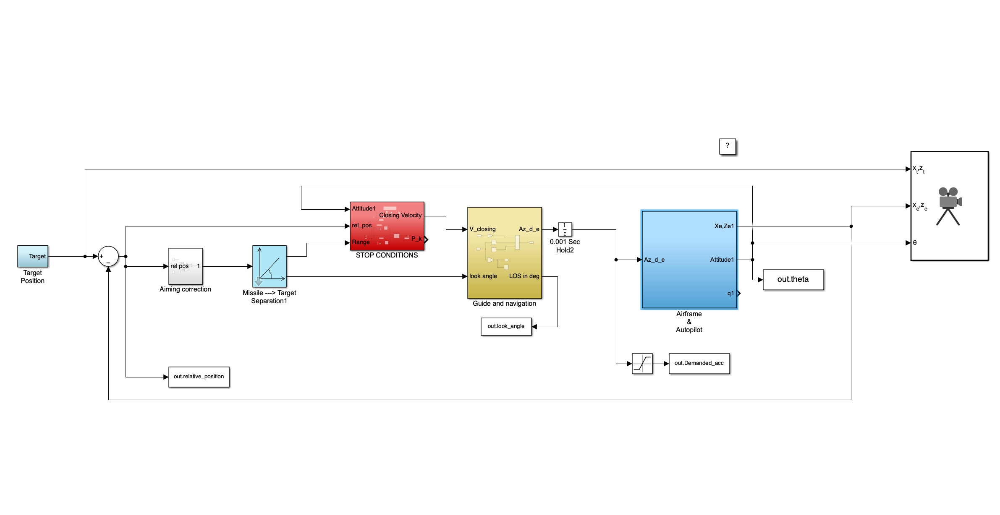

# MATLAB / Simulink code

**Numerical models and supporting calculations for the SAGITTARIUS academic design project.**

This folder contains the original source material used in the simulation-led design study. At project level, the MATLAB/Simulink environment provided a common basis for connecting inputs from different disciplines, studying simulated responses and comparing design assumptions.

For the overall project and its methodology, start with the [main README](../README.md). For the documented simulation and design results, see the [technical report](../documents/SAGITTARIUS_REPORT_FINAL.pdf) and the [published paper](https://doi.org/10.21741/9781644904251-90).

## Code inventory

| File / directory | Purpose |
| --- | --- |
| [`Flight3Dof_V.slx`](Flight3Dof_V.slx) | Main 3-DOF Simulink simulation model |
| [`aero_guid_dat.m`](aero_guid_dat.m) | Scenario data and top-level simulation script |
| [`aero_guid_autop.mat`](aero_guid_autop.mat), [`AimingFun.m`](AimingFun.m) | Supporting data and original MATLAB function |
| [`ThrustFun_booster.m`](ThrustFun_booster.m) | Supporting first-phase model function |
| [`Mass/`](Mass/) | Mass properties and center-of-gravity calculations/data |
| [`Propulsion/`](Propulsion/) | Propulsion-related calculation scripts and inputs |
| [`warhead/`](warhead/) | Preliminary payload-related analytical study and data |
| [`Sustain sizing/`](Sustain%20sizing/) | Original sizing-study folder retained for traceability |
| [`runfg.bat`](runfg.bat) | Original FlightGear helper script |
| [`ORIGINAL_NOTES.md`](ORIGINAL_NOTES.md) | Historical development notes from the source project |

The original exported figures are organized in [`../results/scenario_plots/`](../results/scenario_plots/).

## How the numerical work fits into the project

The numerical workflow helped connect **mission-level assumptions**, **subsystem properties**, and **simulated dynamic responses**. Its key engineering purpose was to make cross-disciplinary decisions comparable: when a design parameter changed, the implications could be discussed in terms of the entire system rather than the isolated subsystem.

  

The [report](../documents/SAGITTARIUS_REPORT_FINAL.pdf) describes the simulation architecture, model assumptions, disciplinary studies and interpretation of the results. The script collection should be read together with that documentation.

## Environment, provenance and reproducibility

These are **original academic research files**, preserved as supplied rather than presented as a standalone software release.

- **Environment:** MATLAB and Simulink; the documented workflow also uses Aerospace Blockset elements and MATLAB numerical/simulation functions. The exact MATLAB release and installed toolbox versions were not recorded here.
- **Starting model:** the report cites a pre-existing MathWorks guidance/simulation example as a starting point for the Simulink implementation. Consult the report and its references for provenance.
- **Dependencies:** several scripts depend on `.mat` files, existing working-directory conventions and other local MATLAB paths. `runfg.bat` contains original machine-specific paths.
- **Development state:** [`ORIGINAL_NOTES.md`](ORIGINAL_NOTES.md) retains the team's historical TODOs and model-integration observations, including a discrepancy between CAD and modeled mass properties. Those notes describe the original code state, not the scope of the project as a whole.
- **Archival choices:** the original `.m`, `.mat` and `.slx` contents have not been refactored. The output plots were moved to `results/`, and the generated `.slxc` cache was not included. Some files under `Sustain sizing/` overlap with `Propulsion/Sustain/` and have been retained rather than silently merged.
- **Reproduction:** no end-to-end execution has been verified against a specific MATLAB installation; some paths or dependencies may require local configuration. The underlying native CAD, CFD and FEM work is presented in the report and slides rather than bundled as editable projects.

## Suggested reading path

1. Read [report Chapter 4](../documents/SAGITTARIUS_REPORT_FINAL.pdf) for the team workflow and its links to system design.
2. Review the Simulink architecture and companion MATLAB scripts alongside **report Chapters 5–6**.
3. Explore the project-specific calculation folders and **report Chapters 7–9**.
4. Compare the exported [simulation plots](../results/README.md) with **report Chapter 10**.

The original code is included as **evidence of the engineering process**, with implementation details and assumptions documented here instead of crowding the project overview.
