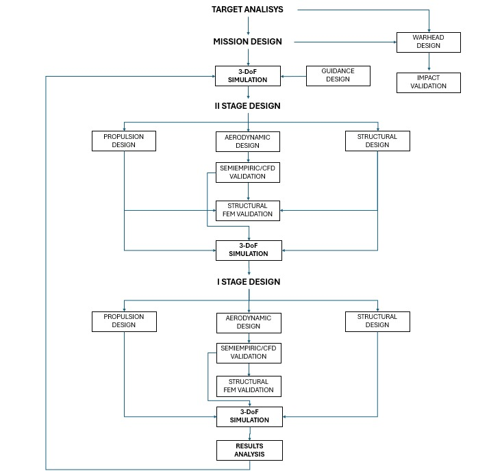
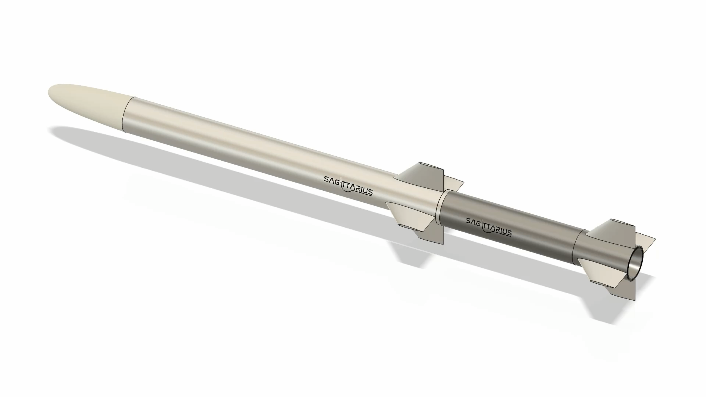
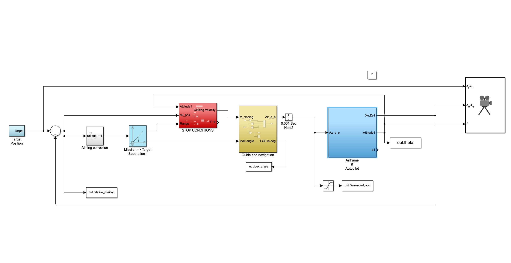
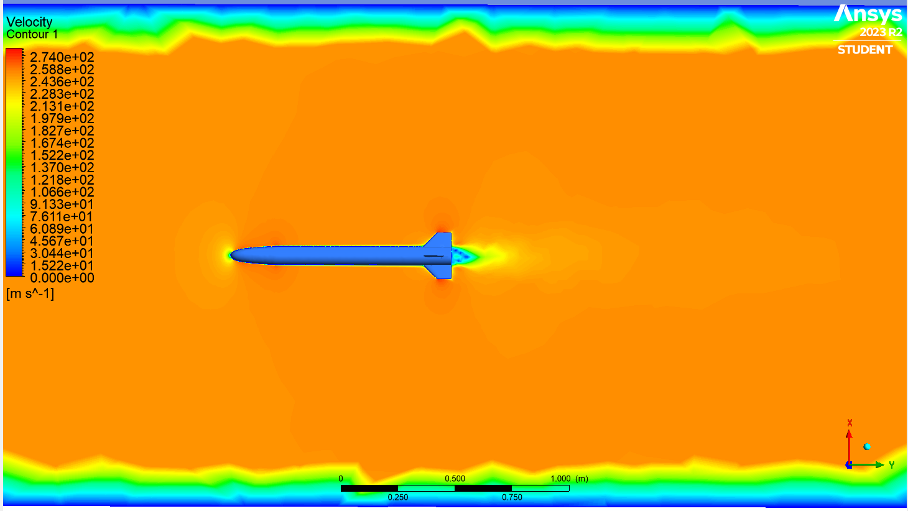
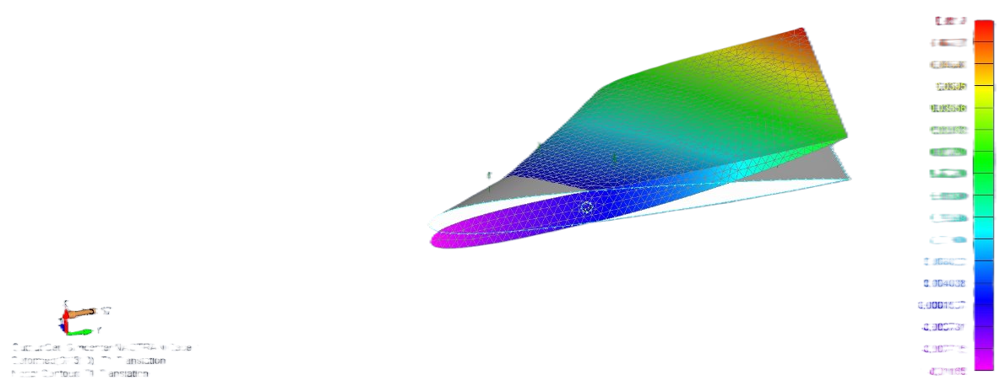
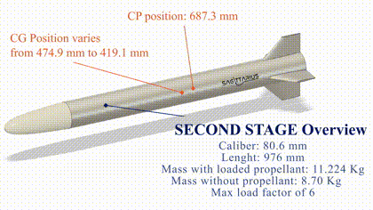

# Project media

Selected visuals and animated excerpts from the original SAGITTARIUS project materials, organized for browsing on GitHub.

## Engineering highlights

| Preview | Subject |
| --- | --- |
|  | Original concurrent-engineering workflow |
|  | Preliminary mechanical configuration |
|  | Simulink model and functional blocks |
|  | CFD analysis visual |
|  | Structural analysis visual |

Additional selected figures are in [`highlights/`](highlights/), including mechanical integration and scenario-response plots.

## Animated previews and videos

| Preview | Video |
| --- | --- |
|  | [Reference simulation](videos/reference_scenario.mp4) |
|  | [Off-design simulation](videos/diving_target.mp4) |
|  | [Mechanical assembly overview](videos/cad_overview_clip.mp4) |

Click a preview to open its MP4 file. GIFs are used for inline GitHub display, with video excerpts retained separately.

The images and videos here are curated from the original materials; see the [presentation](../presentation/README.md), [academic report](../documents/SAGITTARIUS_REPORT_FINAL.pdf) and [project overview](../README.md) for their engineering context.
