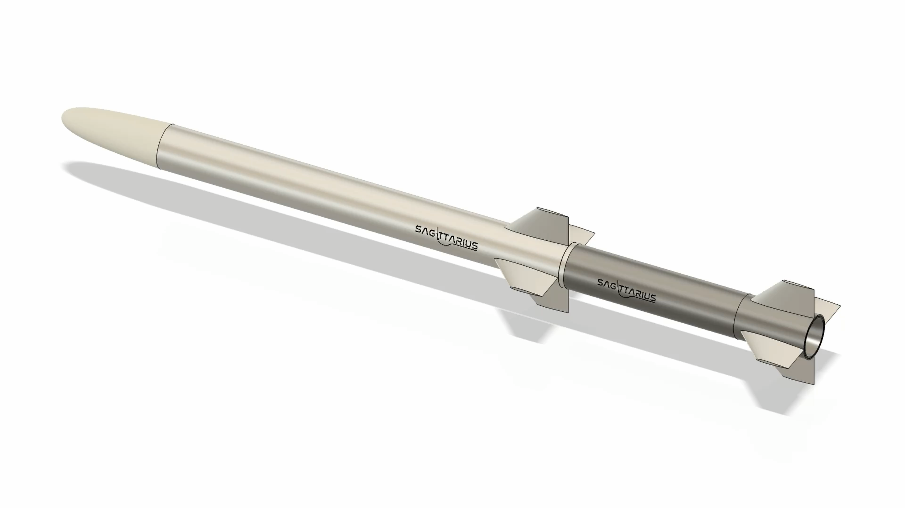

# Project presentation

**[Open the SAGITTARIUS presentation (PDF)](Sagittarius_presentation.pdf)**

The original slide presentation brings the preliminary configuration, simulation environment and multidisciplinary analyses together in a visual narrative.

It covers the mission and design context, team organization, concurrent-engineering workflow, system modeling, disciplinary studies, CAD configuration and selected simulation scenarios.

  

For a shorter introduction, return to the [main project README](../README.md). For the engineering rationale and assumptions behind the figures, refer to the [full design report](../documents/SAGITTARIUS_REPORT_FINAL.pdf).

The curated [media gallery](../media/README.md) contains images and animated excerpts from the presentation that can be viewed directly on GitHub.
