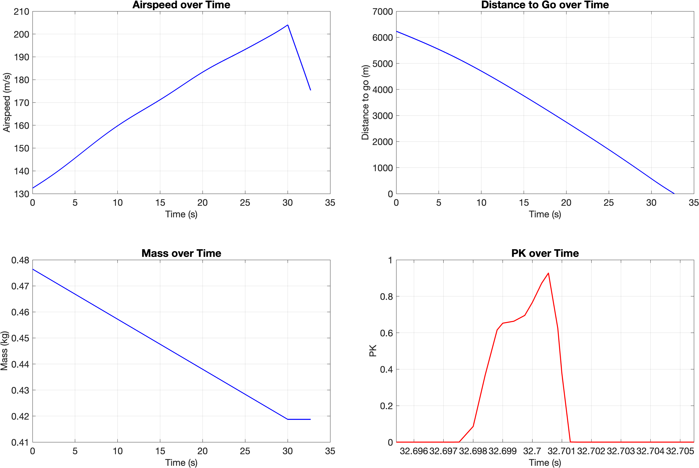

# Simulation results

The [`scenario_plots/`](scenario_plots/) folder contains the exported figures produced for the SAGITTARIUS flight-simulation study. Results are grouped by the original scenario/initial-condition names and include PNG plots and, where available, MATLAB `.fig` files.

These time histories support the **system-level comparison of different simulated cases**. They show how selected response variables evolve when mission conditions change, and complement the reference and off-design studies presented in the report.

  

## How to read the results

The useful question is not just what a single trajectory looks like, but **what changes between scenarios, which assumptions drive those differences, and how the results inform design discussions**.

- **Reference case:** simulation setup and interpretation in [report Chapter 3](../documents/SAGITTARIUS_REPORT_FINAL.pdf).
- **Off-design cases:** comparison and discussion in [report Chapter 10](../documents/SAGITTARIUS_REPORT_FINAL.pdf).
- **Visual demonstrations:** [animated scenarios in the main README](../README.md#simulation-results-and-scenarios).

All figures are numerical simulation outputs from an academic study, not experimental flight measurements. The original model scripts and their historical implementation notes are preserved in [`code/`](../code/README.md).
